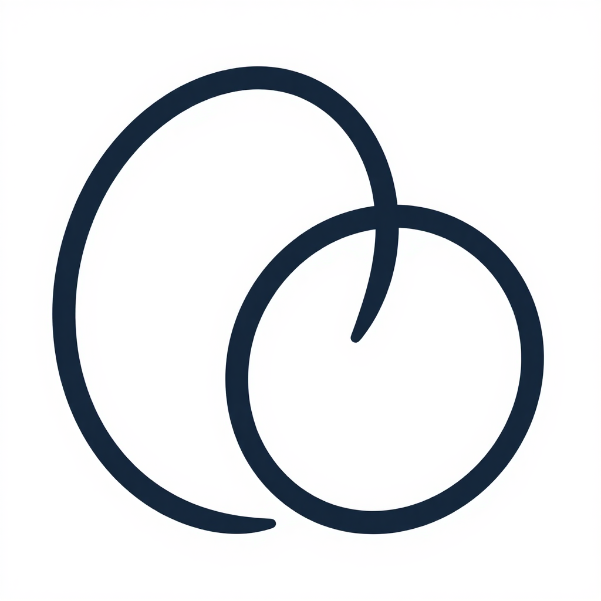

<div align="center">
  
  <h2>ProxyArea</h2>
  <h3>A Lightweight, Secure, Pure-Go REST-Compatible HTTP Forwarder</h3>
</div>

### 1. Introduction

ProxyArea is a lightweight REST-compatible HTTP forwarder in the FasterEdge ecosystem, implemented with the pure Go standard library. Current version `1.0.20261123`.

- Provides fixed routes `/get`, `/post`, `/put`, `/patch`, `/delete`, `/head`, `/options`, `/proxy`, `/healthz`; all routes and all methods preserve the business body byte-for-byte.
- Control fields come from query / explicit JSON envelope / form; the auth precedence is `Authorization: Bearer` → `X-Proxy-Key` → query → envelope → form.
- The allowlist is matched case-insensitively and exactly against `URL.Hostname()`, and is re-validated on every redirect, with a default maximum of 10 hops.
- On top of the hostname allowlist, every DNS-**resolved IP** is validated by a single shared function used by the forward, redirect and CONNECT paths. Loopback / private / link-local / unspecified addresses and IPv4-mapped IPv6 bypasses are rejected, and the dial hook connects to the already-validated IP, closing the DNS-rebinding window.
- Passthrough request bodies and upstream response bodies are both capped (16 MiB / 64 MiB by default, tunable via `--max-request-body` and `--max-response-body`); exceeding a cap returns 413/502 or aborts the connection instead of returning a truncated "successful" response.

### 2. Getting Started

Public deployment (targets are public hostnames, private networks stay closed):

```bash
ProxyArea --addr=:8080 --key=my_secret --allow-hosts=api.example.com --require-allowlist
```

Local tests / controlled internal networks (targets are local or internal):

```bash
ProxyArea --addr=:8080 --key=my_secret --allow-hosts=127.0.0.1,localhost --allow-private-nets
```

Add `--allow-private-nets` only for **local tests / controlled internal networks**: it permits loopback/private/link-local targets (multicast, unspecified and reserved ranges stay blocked even with it enabled). Do not add it for public deployments.

> **Why is loopback rejected by default?** Gate 2 (section 6) classifies targets by their DNS answer, and `127.0.0.0/8` / `::1` are in the categories that resolved-IP validation rejects by default. So configuring `--allow-hosts=127.0.0.1,localhost` and then requesting `http://localhost:8081` gets a 403 — the hostname allowlist only answers "is this name allowed", it does not exempt IP classification. The measured response is `{"error":"目标主机 localhost 解析到 ::1(回环), 拒绝访问: 目标被安全策略拒绝"}`. To open a local chain you must add `--allow-private-nets`.

The existing CLI stays compatible: `--addr`, `--key`, `--https`, `--cert_file`, `--key_file`, `--timeout`, `--target-scheme`, `--allow-hosts`, `--insecure-skip-verify`.

Security-related CLI: `--require-allowlist` (fail startup unless `--allow-hosts` has at least one target), `--max-redirects` (max redirect hops, 0 means the default 10), `--disable-redirects` (do not follow upstream redirects).

Newly added flags (all have defaults, so existing invocations keep working):

| Flag | Default | Meaning |
|---|---|---|
| `--allow-private-nets` | `false` | Allow loopback/private/link-local targets; controlled networks and local tests only |
| `--max-request-body` | `16MiB` | Cap for passthrough (non-control) request bodies |
| `--max-response-body` | `64MiB` | Cap for upstream response bodies |

Size flags accept plain bytes or unit suffixes: `16MiB`, `64MB`, `1KiB`, `1B`.

### 3. Routes

| Path | Upstream Method |
|---|---|
| `/get` | GET |
| `/post` | POST |
| `/put` | PUT |
| `/patch` | PATCH |
| `/delete` | DELETE |
| `/head` | HEAD |
| `/options` | OPTIONS |
| `/proxy` | The client's original method, including extension methods such as PROPFIND |
| `/proxy/` | Same as `/proxy` (the trailing-slash spelling) |
| `/proxy/{get,post,put,patch,delete,head,options}` | Aliases: the client's method is ignored, the alias fixes the upstream method |
| `/connect` | Opens a TCP tunnel (for HTTPS, WebSocket, ...); auth and target validation match `forward` |
| `/healthz` | Health check (returns 200 OK) |

Unknown or deeper `/proxy/...` paths return 404. All routes and all methods preserve the business body byte-for-byte, including GET, HEAD, OPTIONS and DELETE; no Content-Type is added automatically when there is no body.

`/connect` goes through the same auth and the same two gates as every other route: with `--key` configured, a missing credential returns 401; a target outside the allowlist or resolving into a rejected range returns 403 (policy denial) or 502 (resolution failure) via `statusForTargetError`. Writing the allowlist entry as `host:port` prevents opening tunnels to arbitrary ports of the same host.

### 4. Control Fields

`url` is required; `params` is parsed and merged into the target query string (duplicate keys are preserved and encoded only once); `https` accepts boolean values only and takes effect only when the URL has no scheme; `key` is used for compatible authentication.

The precedence for non-auth control fields is **query → explicit JSON envelope → form**. The auth precedence is **`Authorization: Bearer` → `X-Proxy-Key` → query → envelope → form**. Once a higher-precedence source appears, it is not fallen back from even if empty or invalid.

Plain `application/json` is always the business body:

```bash
curl -X PATCH 'http://127.0.0.1:8080/proxy?url=http%3A%2F%2Fapi.example.com%2Fitems%2F1' \
  -H 'Authorization: Bearer my_secret' -H 'Content-Type: application/json' \
  -d '{"name":"new"}'
```

urlencoded and multipart can carry `url`, `params`, `https`, `key`, and forward the original form (including control fields) completely. For business forms, it is recommended to put control fields in the query and auth in the Header.

Forms are capped at **1024 fields** (`controls.go:maxFormFields`, not configurable): exceeding 1024 urlencoded keys or multipart parts returns 413 (measured: 1024 fields → 200, 1025 → 413 `control body too large`), which bounds the parsing cost of hostile field counts.

#### Explicit JSON Envelope

Media type: `application/vnd.proxyarea.proxy+json`.

```json
{
  "url": "https://api.example.com/items",
  "params": "trace=1&tag=a&tag=b",
  "https": true,
  "key": "my_secret",
  "encoding": "json",
  "body": {"name":"new"},
  "contentType": "application/json"
}
```

`encoding` supports: `none` (default, must not carry a body), `json`, `text`, `base64`. Unknown fields, extra JSON values, invalid encoding/base64/contentType all return 400; the control body limit is 8 MiB, exceeding it returns 413.

### 5. URL, Headers and Errors

Only http/https are allowed; userinfo, control characters, missing hostnames and invalid ports are rejected. URLs without a scheme use `https=true` or `--target-scheme`. The allowlist is matched case-insensitively and exactly against `URL.Hostname()`, and is re-validated on every redirect, with a default maximum of 10 hops. On top of the hostname match, every hop also classifies the DNS answer; see section 6.

Both requests and responses strip the standard hop-by-hop headers and any headers dynamically specified by `Connection`; Host, Content-Length, Authorization, X-Proxy-Key are not forwarded. Multi-valued end-to-end headers (e.g. Set-Cookie) are preserved.

**Origin headers.** Client-supplied `X-Forwarded-For`, `Forwarded` and `X-Real-IP` are **deleted**, and `X-Forwarded-For` is rewritten from the real TCP peer address (left unset when the peer host cannot be determined). Upstream authorization based on those headers therefore cannot be spoofed by the client. If the envelope replaced the body, `Content-Encoding` is removed as well.

Error mapping: 400 control/URL errors, 401 auth failure, 403 allowlist or resolved-IP rejection, 404 unknown alias, 413 request body too large (control or passthrough), 502 upstream/redirect failure, DNS resolution failure, or response body too large, 504 timeout.

**403 vs 502.** The same "policy denial" carries different status codes on the two paths, and the difference matters:

| Scenario | Status | Measured response |
|---|---|---|
| A direct request whose target is outside the allowlist / resolves into a rejected range | `403` | `{"error":"目标主机 127.0.0.1 解析到 127.0.0.1(回环), 拒绝访问: 目标被安全策略拒绝"}` |
| A **redirect** hop that is outside the allowlist / resolves into a rejected range | `502` | `{"error":"上游请求失败: Get \"http://example.com/\": 目标主机不在白名单内: example.com"}` |

Redirect validation runs inside `http.Client.CheckRedirect` (`proxy.go:103-107`), so the error can only bubble back through `client.Do`, and `forward` maps every error from `Do` to 502 ("upstream or redirect failure"). The 502 body's `上游请求失败: Get "...": 目标主机不在白名单内` is what tells the two apart. The `/connect` tunnel endpoint never goes through `client.Do`, so a policy denial there is a plain 403.

### 6. Security

ProxyArea can reach any target it is told to, so its boundary has **two** gates, and both matter:

**Gate 1: the target allowlist.** With `--allow-hosts` empty, any target is allowed (including private networks) and gate 1 is disabled. When configured, entries match `URL.Hostname()` case-insensitively, in two forms — `host` (any port) and `host:port` (exact host+port, so `/connect` cannot port-scan an allowlisted host) — and are re-matched on every redirect hop.

**Gate 2: resolved-IP validation.** The allowlist matches a *name*; where the connection actually lands depends on what DNS returns. So the forward, redirect and CONNECT paths all call one shared function (`validateTarget` → `checkResolvedIPs`), classify every resolved address, and reject the whole target if **any** address falls in a forbidden range — it never picks a "safe-looking" IP to connect to:

| Range | Meaning | Released by `--allow-private-nets` |
|---|---|---|
| `127.0.0.0/8`, `::1` | loopback | yes |
| `10/8`, `172.16/12`, `192.168/16`, `fc00::/7` | private | yes |
| `169.254.0.0/16`, `fe80::/10` | link-local (incl. cloud metadata `169.254.169.254`) | yes |
| `100.64.0.0/10` | carrier-grade NAT | yes |
| `0.0.0.0`, `::` | unspecified | no |
| `224.0.0.0/4`, `ff00::/8` | multicast | no |
| `240.0.0.0/4` | reserved, including the limited broadcast `255.255.255.255/32` | no |
| `198.18.0.0/15` | benchmarking (RFC 2544) | no |
| `192.0.2.0/24`, `198.51.100.0/24`, `203.0.113.0/24` | TEST-NET-1/2/3 documentation (RFC 5737) | no |
| `2001:db8::/32`, `3fff::/20` | IPv6 documentation | no |
| `2001:2::/48` | IPv6 benchmarking | no |
| `100::/64` | IPv6 discard prefix (RFC 6666) | no |
| `64:ff9b::/96`, `64:ff9b:1::/48` | NAT64 (RFC 6052/8215), embeds any IPv4 | no |
| `2002::/16`, `2001::/32` | 6to4 / Teredo, embeds any IPv4 | no |

The standard library's `net.IP.IsPrivate/IsMulticast/IsLinkLocalUnicast` does not cover the reserved, benchmarking, documentation, broadcast, or NAT64/6to4/Teredo ranges. Measured (section 7) before the fix: `240.0.0.1`, `198.18.0.1`, `255.255.255.255`, `192.0.2.1`, `198.51.100.1`, `203.0.113.1`, `2001:db8::1` and `::ffff:240.0.0.1` were all classified as public and passed. After the fix they all return 403 tagged "保留段". These ranges are **always denied** — `--allow-private-nets` does not release them, otherwise that flag would become an arbitrary-address puncher.

IPv4-mapped IPv6 forms (`::ffff:10.0.0.1`) are normalized to IPv4 before classification; otherwise an IPv6-prefix check would miss them.

**DNS rebinding.** "Validate first, then let the HTTP client resolve again" still leaves a window: an attacker flips the DNS answer to an internal address between the two lookups. ProxyArea installs a dial hook on `Transport.DialContext` (`dialGuarded`) that uses **the same resolution result for validation and for the connection**, dialing the validated IP directly. If DNS changes after validation, the connection still goes to the address that was checked. The supplied Transport is cloned before the hook is installed, so the process-wide `http.DefaultTransport` is never mutated.

**Request and response body caps.** Non-control Content-Types used to stream their body through with no cap at all, which allows an unbounded upload to exhaust memory and bandwidth. Now:

| Cap | Default | CLI | On exceeding |
|---|---|---|---|
| Passthrough request body | 16 MiB | `--max-request-body` | known length → 413; chunked counted while reading → 413 |
| Upstream response body | 64 MiB | `--max-response-body` | known length → 502; chunked aborts the connection |
| Control body | 8 MiB | not configurable | 413 |

Exceeding a cap yields an explicit 413/502 or an aborted connection — **never** a truncated body returned as a success. The flags accept plain byte counts or unit suffixes such as `16MiB` / `64MB`.

**Deployment.** Authentication is off until `--key` is set, so public deployments must configure both `--key` and `--allow-hosts`. `--allow-private-nets` permits loopback/private/link-local targets for controlled networks and local tests only; do not enable it on a public deployment. `--insecure-skip-verify` is limited to controlled test environments. Resolved-IP validation blocks targets whose DNS answer is internal; it does not restrict access to legitimate public targets.

### 7. Build and Test

```bash
go build -o proxyarea .
go vet ./...
go test ./...
go test -race ./...
go test -cover ./...
```

完整手工示例见 [test_usage.md](test_usage.md),配套上游:`go run ./examples/testserver -addr=:8081`。

Measured locally (go1.27.4 / windows/amd64, 2026-11-23): `gofmt -l` prints nothing, `go vet ./...` passes, `go test ./...` passes (107 tests). Reserved-range classification is covered by `TestClassifyIPBlocksReservedRanges`, `TestClassifyIPNormalizesIPv4Mapped`, `TestPrivateTargetRejectedOnAllPaths` (forward and CONNECT paths), `TestRedirectHopRechecksResolvedIP` (per-hop redirect) and `TestAllowPrivateNetsDoesNotOpenReservedRanges`.
